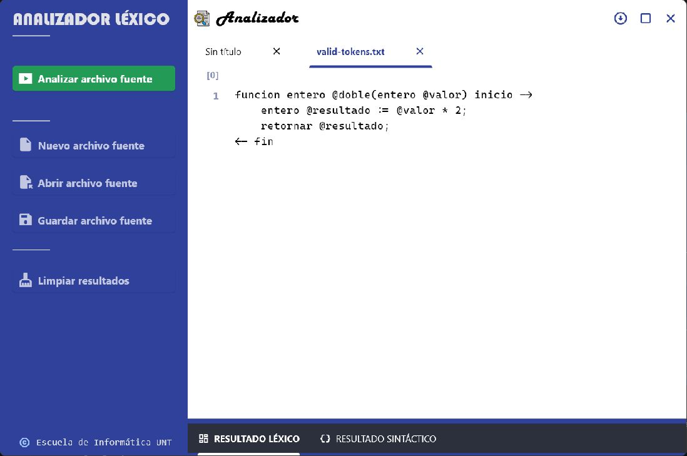
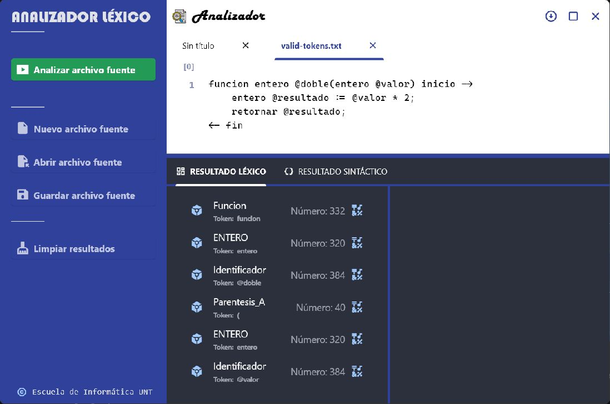
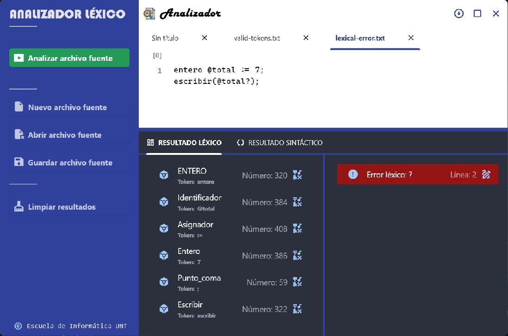
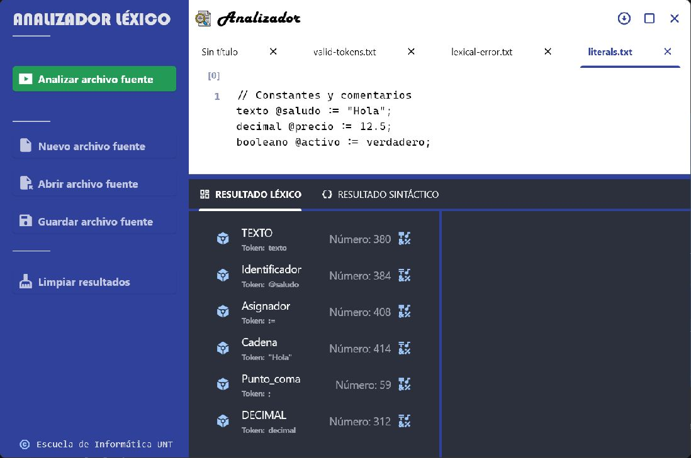

# Flet Lexical Analyzer

Primera versión de un analizador de escritorio para un lenguaje didáctico con palabras clave en español. El editor está hecho con Python y Flet. El motor generado con Flex clasifica los fragmentos del texto en tokens y señala los caracteres desconocidos junto con su número de línea.

La pestaña de sintaxis conserva el texto «Implementación futura» de esta versión. El análisis sintáctico se incorporó en [Flet Language Analyzer (V2)](https://github.com/Yanxmarcos/flet-language-analyzer).

## Capturas

### Editor con una función de ejemplo



### Tokens reconocidos



### Error léxico



### Literales y comentarios




## Reglas léxicas

| Categoría | Ejemplos |
| --- | --- |
| Palabras reservadas | `funcion`, `entero`, `decimal`, `texto`, `retornar` |
| Identificadores | `@valor`, `@total_1`. Después de `@` debe ir una letra, seguida opcionalmente por letras, dígitos o guiones bajos. |
| Literales | Enteros como `7`, decimales como `12.5` y cadenas como `"Hola"`. |
| Operadores | `:=` para asignación, `+`, `-`, `*` y `/` para aritmética. |
| Delimitadores | Paréntesis, punto y coma, y las marcas de bloque `->` y `<-`. |
| Comentarios | El lexer omite `// comentario` y `/* comentario */`. |

```text
entero @total := 7;
escribir(@total);
```

En la primera línea, el motor reconoce la palabra reservada `entero`, el identificador `@total`, el operador `:=`, el entero `7` y el punto y coma. Las expresiones regulares y las acciones están en [lex.l](lex.l).

## Ejecutar en Windows

Desde la raíz del repositorio, con Python y G++ de MinGW disponibles en el PATH:

```powershell
New-Item -ItemType Directory -Force build | Out-Null
g++ -std=c++14 programa.cpp -o build/programa.exe
py -m venv .venv
.\.venv\Scripts\python.exe -m pip install "flet[desktop]==0.26.0"
.\.venv\Scripts\python.exe src/main.py
```

La compilación usa el C++ generado incluido en el repositorio. En la app, abre un archivo de texto y pulsa **Analizar archivo fuente**.

- [Tokens de una función](examples/valid-tokens.txt)
- [Literales y comentarios](examples/literals.txt)
- [Carácter desconocido en la línea 2](examples/lexical-error.txt)
